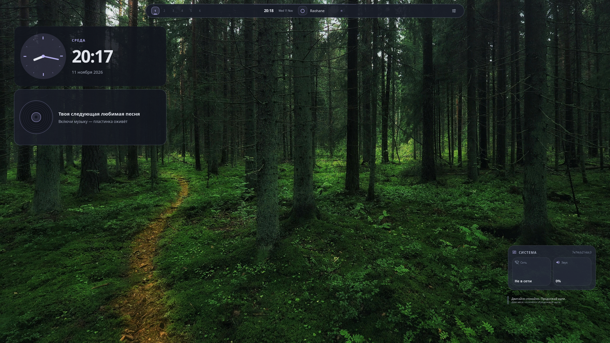
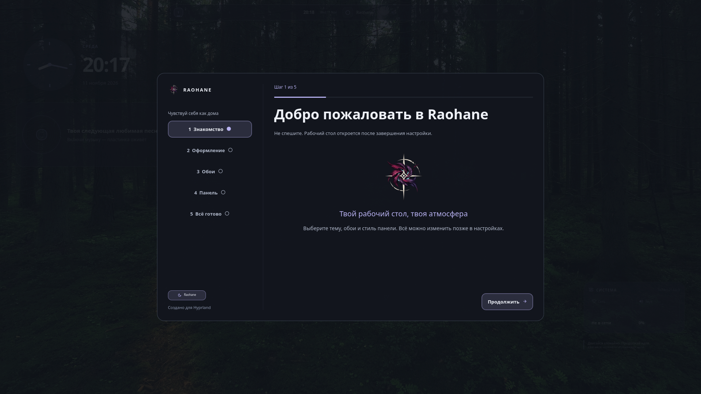
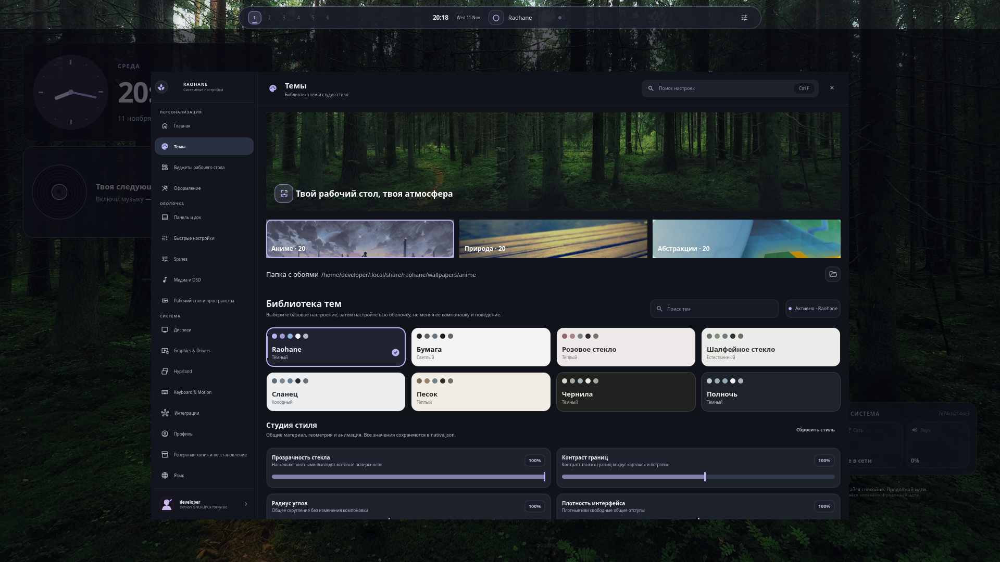
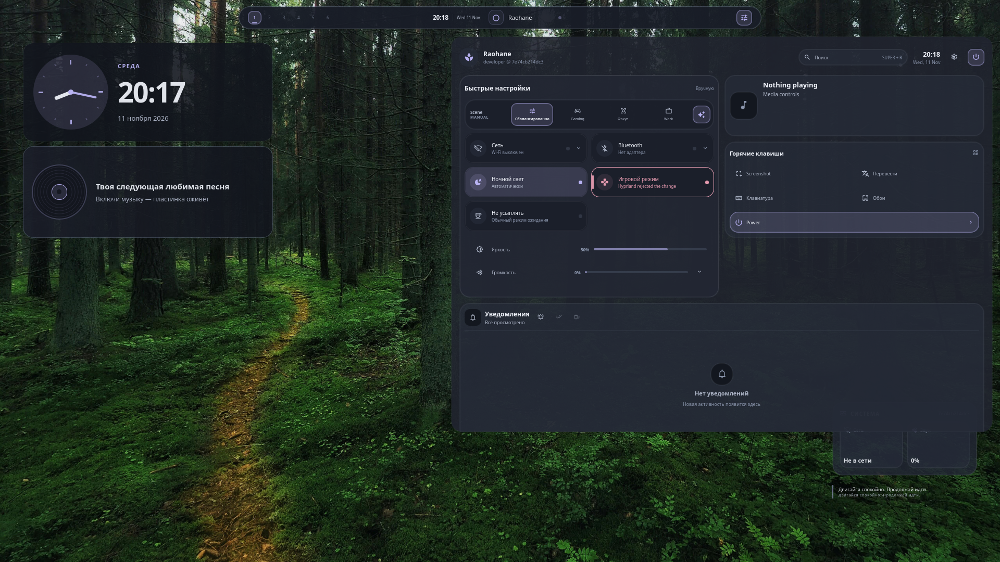
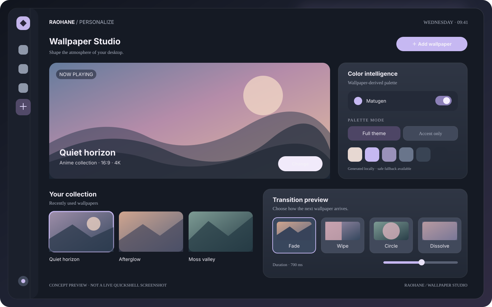

<!--
  Raohane project README
  Screenshots in assets/screenshots are unretouched Quickshell captures.
  The Wallpaper Studio SVG is a concept illustration, not a runtime screenshot.
-->

<div align="center">


# Raohane

### Your desktop. Your atmosphere.

A customizable desktop shell for **Hyprland**, built with **Quickshell, Qt and QML**.

Soft graphite surfaces, restrained accents, adaptive color and thoughtful motion —  
a cohesive desktop environment shaped around the way you work.

<p>
  <a href="#gallery">Gallery</a> ·
  <a href="#features">Features</a> ·
  <a href="#installation">Installation</a> ·
  <a href="#documentation">Documentation</a>
</p>

[English](README.md) · [Русский](README.ru.md)

[](https://github.com/killmyselfrin/raohane-dots/actions/workflows/raohane-audit.yml)
[](LICENSE)


<a href="assets/screenshots/desktop.png">
  
</a>

<sub>Real, unretouched Quickshell capture · 1920 × 1080 · diagnostic Sway session with software rendering.</sub>

</div>

---

## What is Raohane?

Raohane is a standalone desktop shell for **Hyprland**. It brings the everyday surfaces of a desktop into one consistent system: a configurable Bar, Dock, launcher, Control Center, wallpaper library, media surfaces, desktop widgets and a searchable Settings workspace.

The project is built around three principles:

- **One visual language.** Shared surfaces, typography, spacing, colors and motion across the shell.
- **Useful customization.** Configure layouts, modules, widgets, themes and wallpapers without maintaining a pile of unrelated tools.
- **Predictable runtime.** Prefer native Quickshell services, bounded background work and explicit fallbacks over duplicate daemons and unnecessary polling.

Raohane is under active development. It is not currently presented as a fully validated stable release.

## Gallery

These images are **captures of the actual running Quickshell interface**, not generated mockups. They were captured on 11 November 2026 from source commit `a038d025024a5aeee9a70a55de183ed469478ac5`.

<table>
<tr>
<td width="50%" valign="top">
<a href="assets/screenshots/welcome.png"></a>

**Welcome**

<sub>First-run setup and appearance onboarding.</sub>
</td>
<td width="50%" valign="top">
<a href="assets/screenshots/settings.png"></a>

**Settings**

<sub>Theme library and wallpaper browsing entry points.</sub>
</td>
</tr>
<tr>
<td colspan="2">
<a href="assets/screenshots/control-center.png"></a>

**Control Center**

<sub>Quick controls and system surfaces. Device availability reflects the isolated capture environment.</sub>
</td>
</tr>
</table>

<details>
<summary><strong>Screenshot conditions and limitations</strong></summary>

The screenshots are direct `grim` captures at 1920 × 1080 logical pixels, scale 1, from Quickshell 0.3.2 / Qt 6.11.2 running in a headless Sway + pixman diagnostic environment with `QT_QUICK_BACKEND=software`. No GPU was exposed to the container, so Hyprland could not initialize its rendering backend.

They demonstrate the rendered interface, but **do not demonstrate Hyprland hardware rendering, compositor blur, GPU performance, real hardware controls, multi-monitor behavior or long-session stability**. Those require validation on a real target system.

The forest desktop wallpaper is “Path” by Risto Saukonpää from KDE Plasma Workspace Wallpapers (LGPLv3). Other thumbnail artwork retains its original credits. Full capture notes and artwork provenance: [assets/screenshots/README.md](assets/screenshots/README.md).

</details>

### Wallpaper Studio — design preview

<p align="center">
  
</p>

<sub>This is a **design concept**, not a screenshot of the running application. It illustrates the intended Material-inspired layout and palette controls.</sub>

## Features

| Area | Capabilities |
| --- | --- |
| **Bar & Dock** | Horizontal and vertical layouts, configurable module order, workspace indicators, auto-hide, clock styles, Context Island and multiple visual presets. |
| **Wallpaper Studio** | Wallpaper library, favorites, saved folder collections, per-monitor overrides, video previews, slideshow scheduling and adaptive colors. |
| **Themes & appearance** | Shared Raohane theme system, built-in presets, user theme import/export, configurable visual density and motion preferences. |
| **Dynamic color** | Built-in wallpaper palette extraction, optional Matugen provider, accent-only coloring and full Material You role mapping. |
| **Wallpaper transitions** | Random or custom transition selection; Fade, Wipe, Circle and Dissolve for still wallpapers. |
| **Widget Studio** | Desktop clock, media/context and system widgets; Classic, Minimal and Aurora visual faces; editable desktop placement. |
| **Launcher & Overview** | Keyboard-oriented app/action search, workspace navigation and running-window overview. |
| **Control Center** | Network, Bluetooth, audio, microphone, brightness, notifications and quick system actions. |
| **Media** | MPRIS playback controls, album art, lyrics, media capsule and fullscreen overlay. |
| **Utilities** | Screenshots, screen recording, OCR/translation, clipboard history, on-screen keyboard, Task Manager and session controls. |
| **Scenes** | Balanced, Gaming, Focus and Work behavior profiles. |

Feature availability depends on installed optional packages and the current desktop session. See the relevant documentation before relying on hardware-specific behavior.

## Installation

### Arch Linux and derivatives

Raohane targets an existing **Hyprland** session. Clone the repository and run the guided installer:

```bash
git clone https://github.com/killmyselfrin/raohane-dots.git
cd raohane-dots
bash install.sh
```

The installer checks dependencies, explains required changes and requests permission before system-level actions. Review the package plan before proceeding.

For an unattended installation:

```bash
bash install.sh --yes
```

The unattended mode accepts the installer's default choices. GPU drivers are not automatically replaced.

Dependencies are split into:
- [Required runtime packages](install/arch/required.txt)
- [Optional feature packages](install/arch/features.txt)

### NixOS / Home Manager

The flake exports a package, a NixOS module and a Home Manager module. See the [Nix installation guide](docs/NIX.md) and the [module definitions](nix/).

## Update

Run these commands from the checkout used to install Raohane:

```bash
git pull --ff-only
./install-raohane.sh --no-deps --no-login-theme
raohane restart
```

Pulling source changes alone does not replace the installed runtime under `~/.config/quickshell/raohane`. Re-run the installer when runtime dependencies or installation files change.

## Commands

| Command | Purpose |
| --- | --- |
| `raohane launcher` | Open the application launcher |
| `raohane control` | Open Control Center |
| `raohane settings` | Open Settings |
| `raohane media` | Open the media overlay |
| `raohane desktop` | Open desktop controls |
| `raohane wallpaper` | Open the wallpaper selector |
| `raohane session` | Open session and power controls |
| `raohane translate` | Start screen translation |
| `raohane doctor all` | Inspect installation and runtime dependencies |
| `raohane doctor performance` | Inspect process CPU, RSS, threads and service restarts |
| `raohane validate smoke` | Check current-session IPC and significant QML errors |

Launcher search supports app names, `/` for actions, `>` for commands, `=` for calculations and `:` for clipboard history.

## Appearance and configuration

The native settings file is:

```text
~/.config/raohane/native.json
```

User themes are stored separately in:

```text
~/.config/raohane/themes.json
```

The Settings interface is the recommended way to change everyday preferences. The theme CLI can list, import, export and remove user presets:

```bash
raohane theme list
raohane theme import ~/Downloads/my-theme.json
raohane theme export my-theme ~/Downloads/my-theme.json
raohane theme remove my-theme
```

See [Theme format](docs/THEMES.md) for the JSON schema and validation rules.

### Wallpaper colors and Matugen

Wallpaper Studio supports the built-in palette extractor and an optional **Matugen** provider. Matugen is not required to run Raohane.

- The built-in provider remains the fallback when Matugen is not installed or returns unusable output.
- Matugen is invoked in a bounded, non-interactive dry-run using a temporary isolated configuration; the user's Matugen templates and hooks are not loaded.
- The extracted palette can drive Adaptive Accent / Bar Chromatic Flow. The full Material You option maps validated Material roles into the shared Raohane theme.
- Video wallpapers use a bounded still-frame sample; there is no continuous video color analysis daemon.

Install Matugen separately using the [upstream instructions](https://github.com/InioX/matugen). Implementation notes and limitations are documented in [Wallpaper Studio redesign](docs/WALLPAPER-STUDIO-MATERIAL-REDESIGN.md).

## Project status and validation

**Current source version:** `1.3.0-dev` ([VERSION](VERSION)).

Raohane is actively developed. Automated audits validate source boundaries, configuration contracts, localization and selected integration invariants. They do **not** prove that every feature works correctly on every Hyprland/GPU combination.

Before treating a build as release-ready, validate it on real hardware: installation and upgrade, horizontal/vertical Bar, focus and shortcuts, multi-monitor layouts, fullscreen/game behavior, audio/network devices, wallpaper/video playback, PAM/Polkit, suspend/resume and long-session resource usage.

Useful checks:

```bash
bash scripts/raohane-audit.sh
bash scripts/runtime-payload-audit.sh
raohane doctor all
raohane validate smoke
```

The full live release procedure is in [Release validation](docs/RELEASE-VALIDATION.md). Known open stabilization work is tracked in the [roadmap](docs/ROADMAP.md).

## Documentation

- [Architecture](docs/ARCHITECTURE.md)
- [Roadmap](docs/ROADMAP.md)
- [Release validation](docs/RELEASE-VALIDATION.md)
- [Theme format and user presets](docs/THEMES.md)
- [Wallpaper Studio 2.0](docs/WALLPAPER-STUDIO-2-VALIDATION.md)
- [Wallpaper Studio Material redesign and Matugen](docs/WALLPAPER-STUDIO-MATERIAL-REDESIGN.md)
- [Bar, Welcome and wallpaper collection](docs/BAR-WELCOME-PACK-VALIDATION.md)
- [Halo Bar and Chromatic Flow](docs/HALO-BAR-VALIDATION.md)
- [Desktop Widget Face Library](docs/WIDGET-FACE-LIBRARY.md)
- [NixOS / Home Manager](docs/NIX.md)
- [Contributing](CONTRIBUTING.md)
- [Localization](translations/l10n/README.md)
- [Changelog](CHANGELOG.md)
- [Screenshot capture notes and artwork credits](assets/screenshots/README.md)

## Credits and license

Raohane is developed and maintained by [@killmyselfrin](https://github.com/killmyselfrin).

Released under the [GNU General Public License v3.0](LICENSE). Retained or adapted code, translations and assets preserve their applicable licenses and attribution; see [NOTICE-UPSTREAM.md](NOTICE-UPSTREAM.md), [wallpaper credits](assets/wallpapers/README.md) and [screenshot notes](assets/screenshots/README.md).
