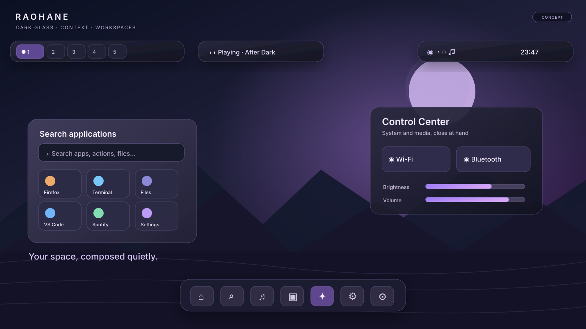
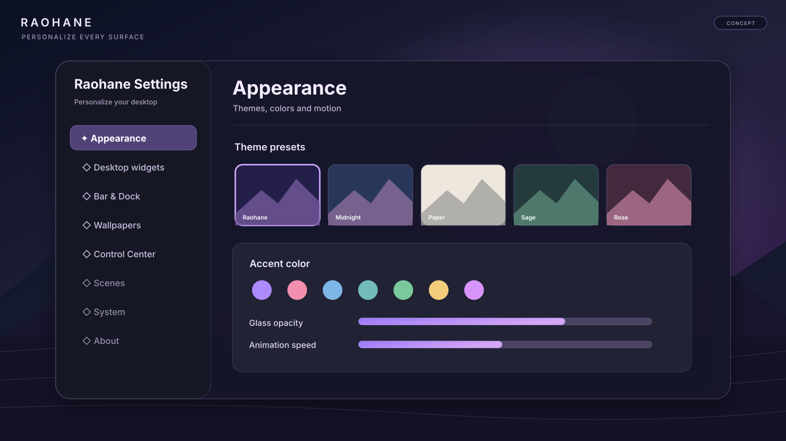
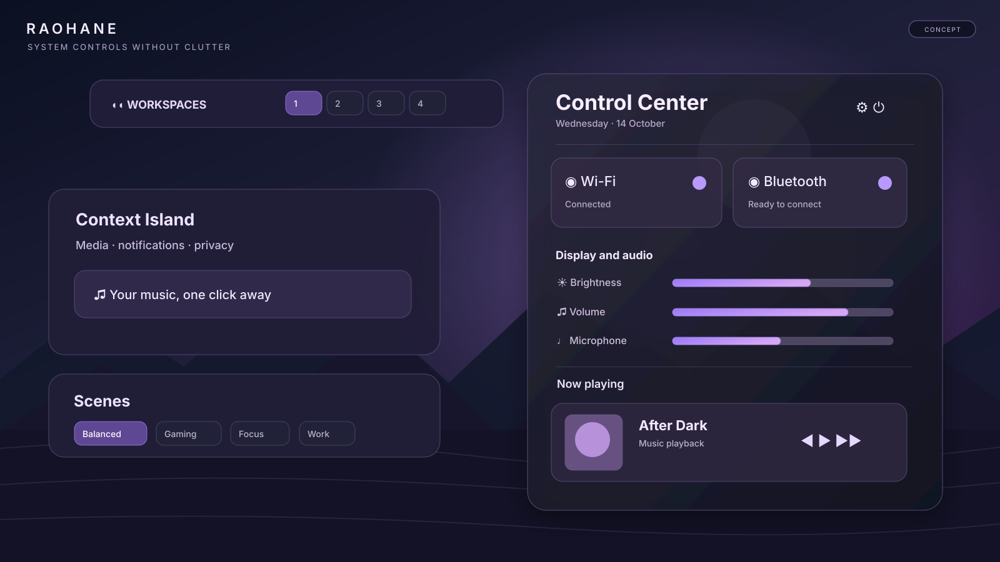

<div align="center">

# Raohane

**A customizable, atmospheric desktop shell for Hyprland.**  
Built with **Quickshell + Qt/QML**. Made to feel fast, consistent, and personal.

[](.github/workflows/raohane-audit.yml)
[](.github/workflows/release-boundary.yml)
[](LICENSE)




*Nocturne desktop — design concept, not a screenshot of a running build.*

[Installation](#installation) · [Features](#features) · [Gallery](#design-gallery) · [Configuration](#configuration) · [Documentation](#documentation)

</div>

> [!IMPORTANT]
> **The images in this README are illustrative UI concepts.** They are not captures from Hyprland. Exact geometry, controls, and interactions may differ from the currently released shell; some depicted ideas are still being developed. See [release validation](docs/RELEASE-VALIDATION.md) for the distinction between static checks and tested runtime behavior.

## Design gallery

<table>
<tr>
<td width="50%">
<br>
<strong>Settings &amp; personalization</strong><br>
<sub>Shared design tokens, theme presets, surfaces, and compact navigation.</sub>
</td>
<td width="50%">
<br>
<strong>Control Center &amp; Context Island</strong><br>
<sub>Connected devices, media, audio/display controls, and contextual scenes.</sub>
</td>
</tr>
</table>

**The direction:** deep graphite glass, cool blue-black backgrounds, restrained lavender highlights, floating Bar pods, and lightweight motion. Actual screenshots will replace or complement these concepts as visual validation on real hardware is completed. [Showcase assets](assets/showcase/README.md).

## Features

| Surface | What Raohane provides |
| --- | --- |
| **Bar &amp; Dock** | Horizontal/vertical bars, configurable modules, workspaces, system tray, Context Island, and a dock. |
| **Launcher &amp; Overview** | Search for apps and actions, navigate workspaces and switch between windows. |
| **Control Center** | Wi-Fi, Bluetooth, audio, microphone, display brightness, notifications, and Scenes. |
| **Settings &amp; Themes** | Central settings, theme presets, JSON theme import/export, live appearance controls, and desktop widgets. |
| **Scenes** | Balanced, Gaming, Focus, and Work modes with application rules and contextual runtime policies. |
| **Media** | MPRIS controls, synced/plain lyrics, a music surface, and a fullscreen media overlay. |
| **Utilities** | Screenshots, recording, OCR, translation, clipboard tools, on-screen keyboard, task manager, and power/session controls. |
| **System integration** | Native service adapters for Hyprland, Wayland, PipeWire, NetworkManager, and Bluetooth. |

Raohane maintains its own runtime and dependency manifests. It does not install another shell as a runtime dependency.

**Current source version:** `1.2.1` (see [VERSION](VERSION) and [CHANGELOG](CHANGELOG.md)). The project remains under active development; static GitHub Actions checks do **not** certify long-session, multi-monitor, or GPU-specific stability. Review the [roadmap](docs/ROADMAP.md) and [release validation](docs/RELEASE-VALIDATION.md).

## Installation

### Arch Linux and derivatives

Install from an existing Hyprland session:

```bash
git clone https://github.com/killmyselfrin/raohane-dots.git
cd raohane-dots
bash install.sh
```

The guided installer checks dependencies, explains missing packages, asks permission for system changes, sets up the Raohane runtime and Hyprland integration, and can install the optional SDDM login theme. The visual onboarding opens on first launch.

After reviewing the package changes, an unattended installer is available:

```bash
bash install.sh --yes
```

Dependencies: [required packages](install/arch/required.txt) · [optional features](install/arch/features.txt). GPU drivers are **not** automatically replaced. The developer/upgrade backend is `install-raohane.sh`.

### NixOS and Home Manager

The flake exports a package, a NixOS module, and a Home Manager module. Follow [Nix installation](docs/NIX.md).

## Update

From the checkout used to install Raohane:

```bash
git pull --ff-only
./install-raohane.sh --no-deps --no-login-theme
raohane restart
```

Pulling repository changes alone does not replace the installed runtime under `~/.config/quickshell/raohane`. Re-run the guided installer when dependencies change.

## Commands

| Command | Action |
| --- | --- |
| `raohane launcher` | Open the application launcher |
| `raohane control` | Open Control Center |
| `raohane settings` | Open Settings |
| `raohane media` | Open the media overlay |
| `raohane desktop` | Open desktop controls |
| `raohane wallpaper` | Open the wallpaper selector |
| `raohane session` | Open power and session controls |
| `raohane translate` | Start screen translation |
| `raohane doctor all` | Inspect installation and runtime |
| `raohane validate smoke` | Inspect current-session IPC and significant QML errors |

Launcher search modes: app names · `/` built-in/contextual actions · `>` commands · `=` calculations · `:` clipboard history.

## Configuration

Settings are stored at `~/.config/raohane/native.json`. Scene state and application rules are tracked separately under XDG state paths, so temporary scene policies don't overwrite base preferences. User autostart commands belong in `~/.config/raohane/autostart.conf`.

The default **Raohane** theme combines dark charcoal glass with lavender accents. Built-in alternatives include **Paper, Rose Glass, Sage Glass, Slate, Sand, Ink,** and **Midnight**. Use Settings or `raohane theme` to select, import, and export themes. See [theme format](docs/THEMES.md).

## Troubleshooting

```bash
raohane doctor all
raohane status
raohane logs
raohane validate smoke
```

To observe a clean foreground startup:

```bash
raohane stop
raohane run
```

For performance or disappearing-panel reports, capture the installed version, GPU/compositor details, recent logs, process CPU/RSS while the issue occurs, and exact reproduction steps. Hardware/runtime issues should be tested in a real Hyprland session.

## Documentation

- [Architecture](docs/ARCHITECTURE.md)
- [Release validation](docs/RELEASE-VALIDATION.md)
- [Roadmap](docs/ROADMAP.md)
- [Theme format](docs/THEMES.md)
- [NixOS / Home Manager](docs/NIX.md)
- [Contributing](CONTRIBUTING.md)
- [Localization](translations/l10n/README.md)
- [Changelog](CHANGELOG.md)

## Development

The active Quickshell implementation is under `modules/raohane/`. Verify source and runtime boundaries with:

```bash
bash scripts/raohane-audit.sh
bash scripts/runtime-payload-audit.sh
```

**Static validation does not replace running the shell.** Check behavior, QML logs, screenshots, session actions, and long-session resource usage on target Hyprland hardware before declaring release readiness.

## License

Raohane is released under [GNU GPLv3](LICENSE). Retained/adapted code, translations, data, and assets preserve applicable attribution; see [NOTICE-UPSTREAM.md](NOTICE-UPSTREAM.md). Original showcase illustrations in this README are presentation concepts, not runtime screenshots.
