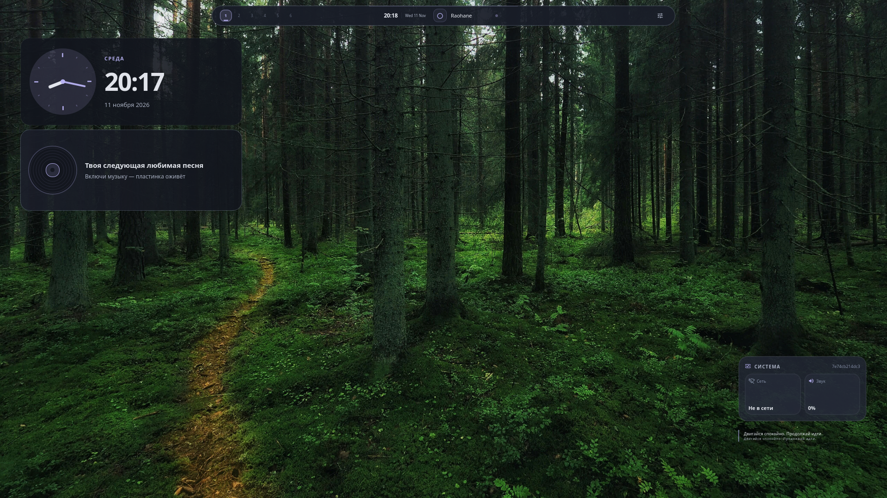
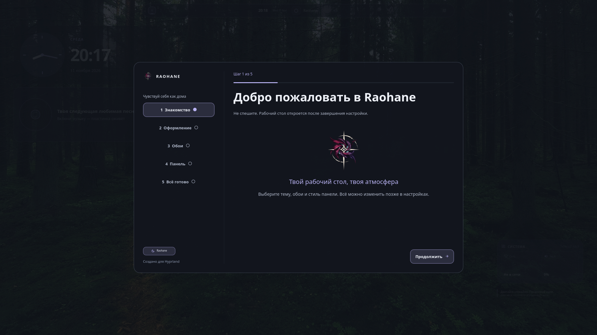
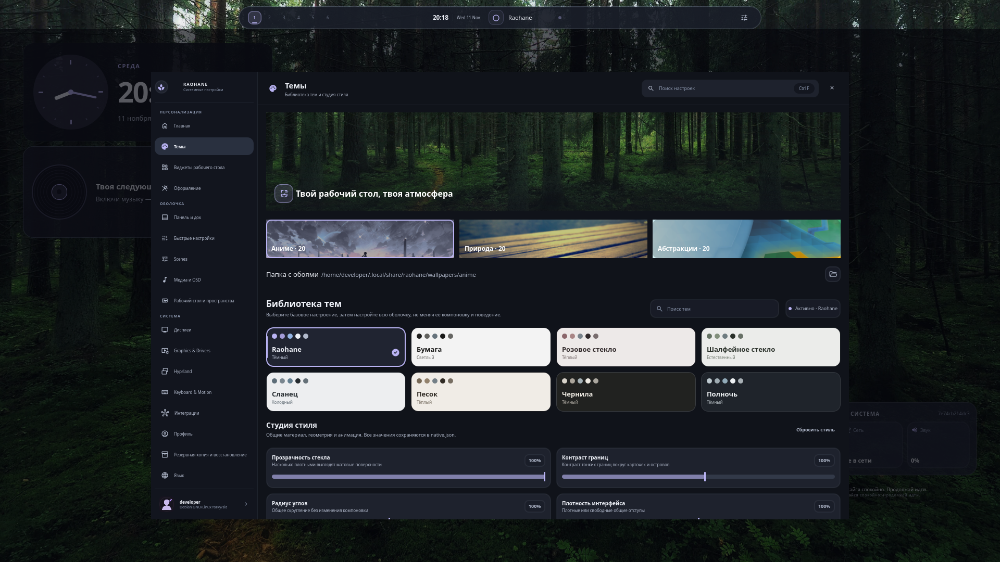
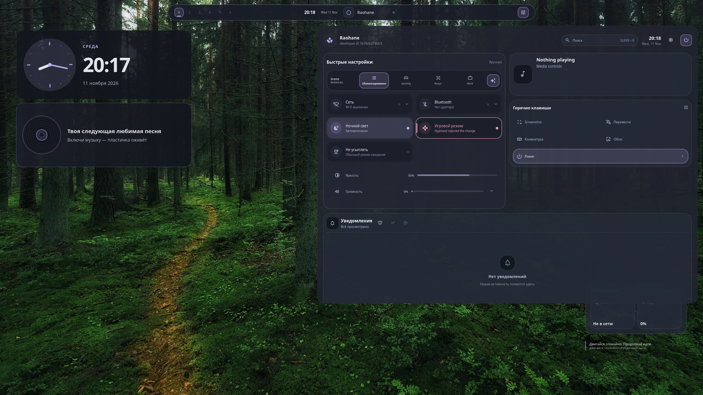

<div align="center">


# Raohane

**Your desktop, your atmosphere.**

A thoughtfully customizable desktop shell for **Hyprland**, built with **Quickshell and Qt/QML**.
Soft graphite. Lavender light. A quieter place to work, create and stay focused.

[Explore the gallery](#gallery) · [Discover features](#features) · [Get started](#installation) · [Read the docs](#documentation) · [Website source](https://github.com/killmyselfrin/raohane-site)

**English** · [Русский](README.ru.md)

[](https://github.com/killmyselfrin/raohane-dots/actions/workflows/raohane-audit.yml)
[](LICENSE)


<a href="assets/screenshots/desktop.png"></a>

<sub>Actual Quickshell render, captured with Sway headless and software rendering. Hyprland hardware behaviour is not represented in this screenshot. [Capture conditions & credits](assets/screenshots/README.md).</sub>

</div>

## A desktop that feels like yours

<table>
<tr>
<td width="33%" valign="top">
<strong>01 / Make space</strong><br>
<sub>Shape the Bar and Dock, arrange desktop widgets, and make the layout work across different screen sizes.</sub>
</td>
<td width="33%" valign="top">
<strong>02 / Set the atmosphere</strong><br>
<sub>Choose wallpaper collections, optional adaptive accents and a consistent, restrained material system.</sub>
</td>
<td width="33%" valign="top">
<strong>03 / Stay in flow</strong><br>
<sub>Reach music, workspaces, quick controls and everyday tools when needed—without a permanently crowded desktop.</sub>
</td>
</tr>
</table>

## Gallery

These are **unedited captures of the running Quickshell interface**, not generated interface concepts.
They were taken at **1920 × 1080** in a Sway headless diagnostic session using software rendering.
Hyprland, compositor blur, GPU performance, hardware controls and long-session behaviour require separate validation.
See [capture details, wallpaper licenses and credits](assets/screenshots/README.md).

<table>
<tr>
<td width="50%" valign="top">
<a href="assets/screenshots/welcome.png"></a><br>
<strong>A calmer first launch</strong><br>
<sub>A five-step setup for appearance, wallpaper and the Bar.</sub>
</td>
<td width="50%" valign="top">
<a href="assets/screenshots/settings.png"></a><br>
<strong>Everything in its place</strong><br>
<sub>Theme choices, wallpaper browsing and coherent controls.</sub>
</td>
</tr>
<tr>
<td colspan="2">
<a href="assets/screenshots/control-center.png"></a><br>
<strong>Everyday controls, together</strong><br>
<sub>Audio, connectivity and session actions; hardware availability reflects the diagnostic environment.</sub>
</td>
</tr>
</table>

## Features

| Area | What you can do |
| --- | --- |
| **Bar & Dock** | Compose horizontal or vertical bars with configurable module ordering, workspaces, Context Island, auto-hide, clock styles and Dock. Choose from ten Bar looks. |
| **Wallpaper Studio 2.0** | Browse offline collections, save favorites and folders, assign wallpapers per monitor, preview video, opt into adaptive colors and schedule rotation. |
| **Theme & motion** | Customize the graphite-and-lavender Raohane look or select alternative themes. Motion policies respect reduced-motion and Gaming scenarios. |
| **Widget Studio** | Arrange desktop clock, media and system widgets, with Classic, Minimal and Aurora visual treatments. |
| **Launcher & Overview** | Search apps and actions, switch workspaces, and find running windows. |
| **Control Center & Scenes** | Access network, Bluetooth, audio, brightness, notifications and Balanced/Gaming/Focus/Work modes. |
| **Media** | MPRIS playback, synchronized or plain lyrics, record-style media card, album-art Now Playing capsule and fullscreen overlay. |
| **Utilities** | Screenshots, recording, OCR, on-demand screen translation, clipboard history, on-screen keyboard, Task Manager and session controls. |
| **System integration** | Hyprland, Wayland, PipeWire and native system-service adapters, without a separate shell runtime dependency. |

**Current source version:** `1.3.0-dev` ([VERSION](VERSION) · [CHANGELOG](CHANGELOG.md)).
Raohane is in **active development**, not a certified stable release. Passing CI validates source and integration boundaries, **not** long-session reliability, multi-monitor setups or GPU/compositor behaviour. Follow the [roadmap](docs/ROADMAP.md) and [release checklist](docs/RELEASE-VALIDATION.md).

## Wallpaper colors and transitions

Open `raohane wallpaper` and turn **Adaptive on** to let the shared widget,
Bar and panel surfaces follow the dominant wallpaper hue. Neutral wallpapers
stay neutral; surfaces retain light/dark tonal depth and text remains readable.
The selected theme is preserved when adaptive colors are turned off.

Confirmed wallpaper changes smoothly interpolate the shared palette. Still-image
transitions wait for decoding and dissolve over the previous image without a
mid-transition dark flash. Style Studio's motion scale and Game Mode control
these animations; a wallpaper transition duration of `0` disables them and
survives restart. Video wallpapers use a one-frame palette sample, not continuous
color extraction; seamless video-to-video blending is not provided.

The palette is shared across the shell and follows the **global wallpaper**;
per-monitor backgrounds do not create separate widget palettes. Live Hyprland
GPU and multi-monitor validation of these transitions remains pending.

## Installation

### Arch Linux and derivatives

Install from an existing Hyprland session:

```bash
git clone https://github.com/killmyselfrin/raohane-dots.git
cd raohane-dots
bash install.sh
```

The guided installer checks dependencies, explains missing packages, asks permission for system changes, sets up the Raohane runtime and Hyprland integration, and can install the optional SDDM login theme. The visual onboarding opens on first launch.

After reviewing the package changes, an unattended installer is available:

```bash
bash install.sh --yes
```

Dependencies: [required packages](install/arch/required.txt) · [optional features](install/arch/features.txt). GPU drivers are **not** automatically replaced. The developer/upgrade backend is `install-raohane.sh`.

### NixOS and Home Manager

The flake exports a package, a NixOS module, and a Home Manager module. Follow [Nix installation](docs/NIX.md).

## Update

From the checkout used to install Raohane:

```bash
git pull --ff-only
./install-raohane.sh --no-deps --no-login-theme
raohane restart
```

Pulling repository changes alone does not replace the installed runtime under `~/.config/quickshell/raohane`. Re-run the guided installer when dependencies change.

## Commands

| Command | Action |
| --- | --- |
| `raohane launcher` | Open the application launcher |
| `raohane control` | Open Control Center |
| `raohane settings` | Open Settings |
| `raohane media` | Open the media overlay |
| `raohane desktop` | Open desktop controls |
| `raohane wallpaper` | Open the wallpaper selector |
| `raohane session` | Open power and session controls |
| `raohane translate` | Start screen translation |
| `raohane doctor all` | Inspect installation and runtime |
| `raohane doctor performance` | Read-only process CPU, RSS, threads, and service restarts |
| `raohane validate smoke` | Inspect current-session IPC and significant QML errors |

Launcher search modes: app names · `/` built-in/contextual actions · `>` commands · `=` calculations · `:` clipboard history.

## Configuration

Settings are stored at `~/.config/raohane/native.json`. Scene state and application rules are tracked separately under XDG state paths, so temporary scene policies don't overwrite base preferences. User autostart commands belong in `~/.config/raohane/autostart.conf`.

The default **Raohane** theme combines dark charcoal glass with lavender accents. Built-in alternatives include **Paper, Rose Glass, Sage Glass, Slate, Sand, Ink,** and **Midnight**. Use Settings or `raohane theme` to select, import, and export themes. See [theme format](docs/THEMES.md).

### Wallpaper collections

The bundled collection works offline. To download the optional mixed anime set:

```bash
python3 scripts/import-anime-wallpapers.py \
  --output "$HOME/.local/share/raohane/wallpapers/anime" \
  --register-config "$HOME/.config/raohane/native.json"
```

Run this from the checkout after the initial installation. The importer uses
pinned URLs and checksums; Python Pillow is required for image validation.
[Collection sources, licenses and usage](assets/wallpapers/README.md).

## Troubleshooting

```bash
raohane doctor all
raohane doctor performance
raohane status
raohane logs
raohane validate smoke
```

To observe a clean foreground startup:

```bash
raohane stop
raohane run
```

For performance or disappearing-panel reports, run `raohane doctor performance` while the issue occurs and compare with a healthy-session snapshot. Include the installed version, GPU/compositor details, `raohane validate smoke`, recent logs, and exact reproduction steps. The read-only process snapshot reports lifetime-average CPU, RSS, threads and service restart counts; it does not measure frame time. Hardware/runtime issues should be tested in a real Hyprland session.

Raohane installs updates **manually by default**; automatic installation can be explicitly enabled in Settings → About. Existing explicit automatic-update preferences remain respected.

If Shelly or another package manager reports that polkit is missing on the system bus, check `systemctl status polkit`, `busctl --system status org.freedesktop.PolicyKit1`, and `pkexec whoami`. The system-wide `polkit` daemon is a required dependency; Raohane also provides its own graphical authorization agent via Quickshell. Do not start a second polkit agent unless the built-in one is unavailable. See [Shelly's polkit troubleshooting guide](https://www.seafoam-labs.org/shelly-alpm/docs/polkit/).

## Documentation

- [Initial setup validation](docs/WELCOME-SETUP-VALIDATION.md)
- [Bar, Welcome and wallpaper validation](docs/BAR-WELCOME-PACK-VALIDATION.md)
- [Architecture](docs/ARCHITECTURE.md)
- [Release validation](docs/RELEASE-VALIDATION.md)
- [Roadmap](docs/ROADMAP.md)
- [Widget Studio 2.0 testing and rollback](docs/WIDGET-STUDIO-2-VALIDATION.md)
- [Widget face library — styles, controls and runtime checks](docs/WIDGET-FACE-LIBRARY.md)
- [Cinematic wallpaper + floating bar validation](docs/CINEMATIC-DESKTOP-VALIDATION.md)
- [Wallpaper Studio 2.0 — features and live tests](docs/WALLPAPER-STUDIO-2-VALIDATION.md)
- [Halo Bar — appearance, native modules and smoke tests](docs/HALO-BAR-VALIDATION.md)
- [Theme format](docs/THEMES.md)
- [NixOS / Home Manager](docs/NIX.md)
- [Contributing](CONTRIBUTING.md)
- [Localization](translations/l10n/README.md)
- [Changelog](CHANGELOG.md)

## Development

Contributions, bug reports and feedback are welcome. Review [CONTRIBUTING.md](CONTRIBUTING.md), the [roadmap](docs/ROADMAP.md), and [release validation](docs/RELEASE-VALIDATION.md) before proposing compositor-facing changes.

<details>
<summary><strong>Codex Cloud integration history and remaining release work</strong></summary>

### Codex Cloud changes in main

The current `main` includes the following reconciled Codex Cloud contributions:

- **Screen translation (#93):** background OCR/translation transaction state is resident in `RaohaneScreenTranslation`; the full-screen presentation is on-demand, and IPC/shortcut entrypoints stay active while it is unloaded.
- **Now Playing island (#145):** bounded album-art decoding, a separate play/pause action and an overlay shortcut, adapted for the current Halo/compact Bar layouts.
- **Motion and visual contracts (#127):** Quick Controls busy indicators respect reduced-motion and Gaming policies; neutral Nocturne design guidance remains the product baseline.
- **Desktop & Spaces preview (#39):** on-demand Settings wallpaper and workspace grid preview, native shortcuts to wallpaper/Overview/widgets, and geometry-aware navigation to controls.
- **Settings navigation (#47):** ranked multiword search with Russian е/ё normalization, a scrollable result list, keyboard-accessible sidebar, and motion-aware page transitions across every Settings page.
- **Bar Studio controls (#100; overlapping #99):** independent workspace count, numbers/dots/minimal indicators, 24-hour/12-hour time, optional seconds, date formatting and synchronized native previews. These settings persist through the v15 native configuration and are indexed by Settings search.

These are code integrations, **not proof of live Hyprland acceptance**. Static checks and source review do not replace compositor testing. The original draft PRs may remain open as historical review records even when selected changes have been ported.

The former Bar proposals [#99](https://github.com/killmyselfrin/raohane-dots/pull/99) and [#100](https://github.com/killmyselfrin/raohane-dots/pull/100) overlap; current `main` uses the consolidated Bar Studio behavior rather than installing both competing Settings panels. The historical #99 alternative indicator and module-settings UI is **not merged wholesale**. The separate [1.3 release candidate (#48)](https://github.com/killmyselfrin/raohane-dots/pull/48) still needs live Hyprland acceptance and must not be promoted as a stable release just because source changes were reconciled.

</details>

The active Quickshell implementation is under `modules/raohane/`. Verify source and runtime boundaries with:

```bash
bash scripts/raohane-audit.sh
bash scripts/runtime-payload-audit.sh
```

**Static validation does not replace running the shell.** Check behavior, QML logs, screenshots, session actions, and long-session resource usage on target Hyprland hardware before declaring release readiness.

## License

Raohane is developed and maintained by [@killmyselfrin](https://github.com/killmyselfrin).

Raohane is released under [GNU GPLv3](LICENSE). Retained/adapted code, translations, data, and assets preserve applicable attribution; see [NOTICE-UPSTREAM.md](NOTICE-UPSTREAM.md). Screenshot credits and capture details are listed in [assets/screenshots](assets/screenshots/README.md). Older concept artwork remains separately labeled in [assets/showcase](assets/showcase/README.md).
