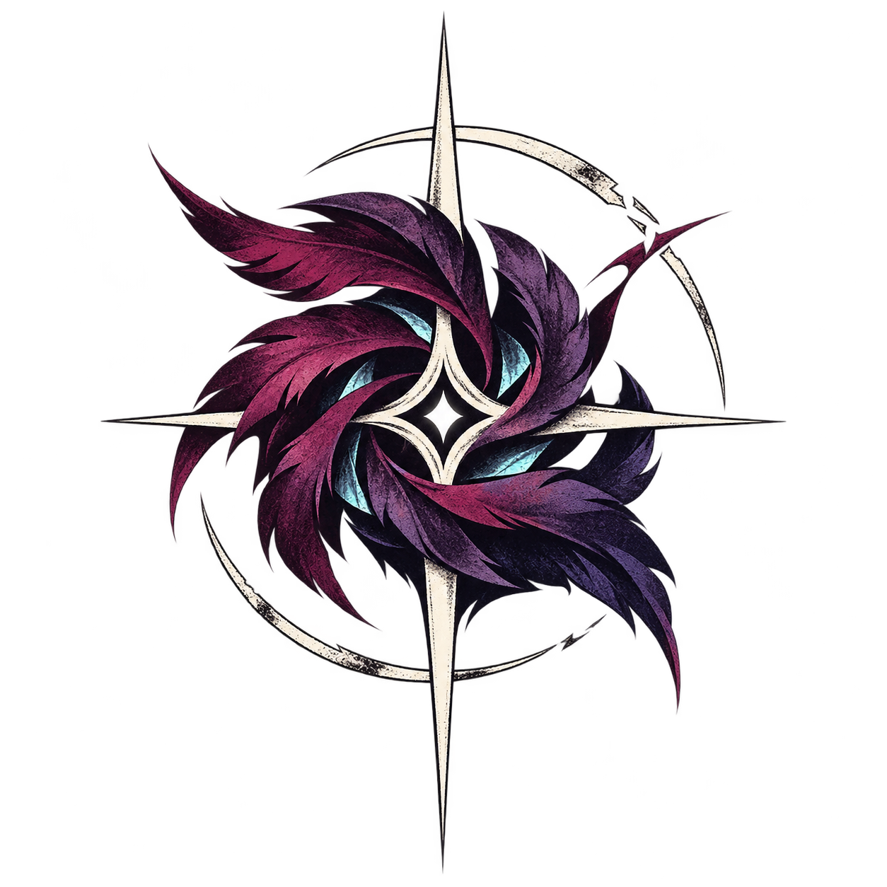
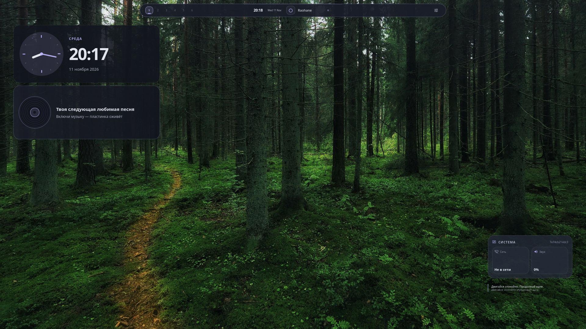
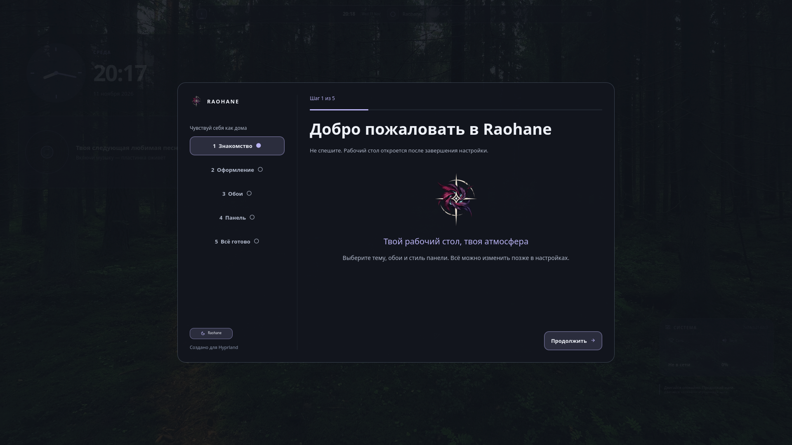
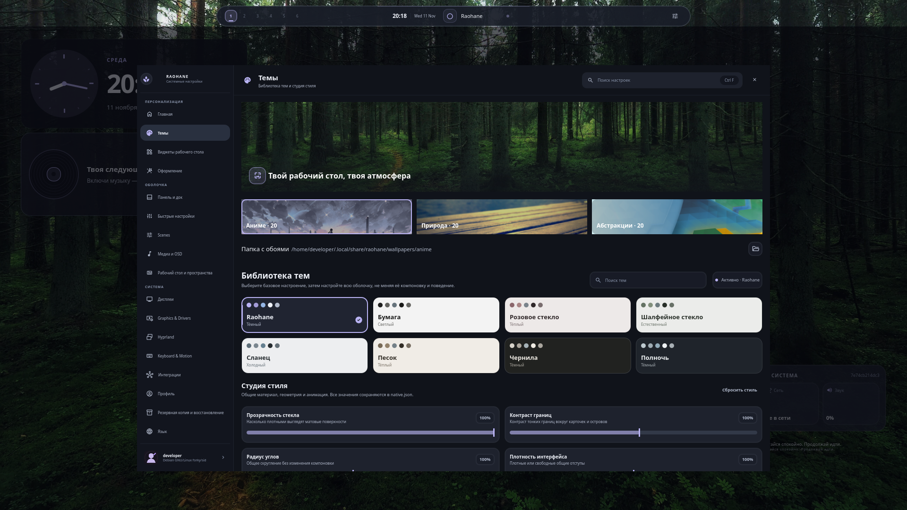
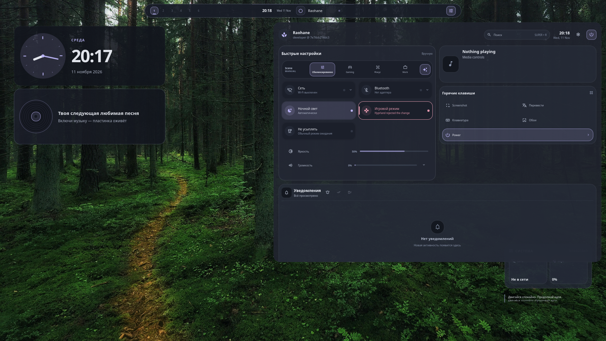

<div align="center">

<a href="README.md">English</a> · <strong>Русский</strong>



# Raohane

**Твой рабочий стол. Твоя атмосфера.**

Независимая настраиваемая оболочка для **Hyprland** на **Quickshell + Qt/QML**.
Графитовые поверхности, мягкие лавандовые акценты и интерфейс, который остаётся на втором плане, когда нужно сосредоточиться.

[Установка](#установка) · [Возможности](#возможности) · [Галерея](#галерея) · [Команды](#команды) · [Документация](#документация)

[](https://github.com/killmyselfrin/raohane-dots/actions/workflows/raohane-audit.yml)
[](LICENSE)


<a href="assets/screenshots/desktop.png"></a>

<sub>Реальный снимок Quickshell в изолированной диагностической среде Sway (software rendering), **не** проверка работы в Hyprland на GPU. <a href="assets/screenshots/README.md">Условия съёмки и авторство</a>.</sub>

</div>

## Галерея

<table>
<tr>
<td width="50%" valign="top"><a href="assets/screenshots/welcome.png"></a><br><strong>Приветствие</strong><br><sub>Пошаговый первый запуск с выбором оформления.</sub></td>
<td width="50%" valign="top"><a href="assets/screenshots/settings.png"></a><br><strong>Настройки</strong><br><sub>Темы, обои и единый язык интерфейса.</sub></td>
</tr>
<tr>
<td colspan="2"><a href="assets/screenshots/control-center.png"></a><br><strong>Центр управления</strong><br><sub>Звук, сеть, устройства и управление сеансом; доступные устройства зависят от системы.</sub></td>
</tr>
</table>

## Возможности

| Раздел | Что доступно |
| --- | --- |
| **Bar & Dock** | Горизонтальная и вертикальная панели, перестановка модулей, десять стилей, Context Island, автоскрытие, часы и рабочие пространства. |
| **Wallpaper Studio 2.0** | Избранное, коллекции папок, отдельные обои для мониторов, видеопредпросмотр, необязательная адаптивная палитра и смена по расписанию. |
| **Темы и анимации** | Графитовая тема Raohane, другие пресеты, общий набор визуальных компонентов и учёт режима уменьшения анимации. |
| **Widget Studio** | Виджеты часов, музыки и системы; редактирование расположения на рабочем столе, варианты Classic / Minimal / Aurora. |
| **Медиа** | Управление MPRIS, тексты песен, музыкальная капсула с обложкой, оверлей плеера. |
| **Инструменты** | Скриншоты, запись, OCR и перевод выделенной области, буфер обмена, экранная клавиатура, диспетчер процессов. |
| **Система** | Wi-Fi, Bluetooth, звук, яркость, уведомления, интеграция с Hyprland/Wayland/PipeWire и режимы Scenes. |

**Состояние проекта:** `1.3.0-dev` — активная разработка. Положительный CI подтверждает статические и архитектурные проверки, но не заменяет испытания реальной сессии Hyprland, долгого времени работы, нескольких мониторов и GPU. См. [план работ](docs/ROADMAP.md) и [проверки релиза](docs/RELEASE-VALIDATION.md).

## Установка

Поддерживаемая цель — **Linux + Hyprland**. Для Arch Linux и производных открой терминал в работающей сессии Hyprland:

```bash
git clone https://github.com/killmyselfrin/raohane-dots.git
cd raohane-dots
bash install.sh
```

Мастер проверит зависимости, покажет необходимые изменения и запросит разрешение на системные действия. Автоматический режим доступен после проверки списка пакетов:

```bash
bash install.sh --yes
```

Для **NixOS / Home Manager**: [инструкция](docs/NIX.md). Драйверы GPU не заменяются автоматически.

### Обновление

```bash
cd ~/raohane-dots
git pull --ff-only
./install-raohane.sh --no-deps --no-login-theme
raohane restart
```

Выполняй команды из **своего каталога клонирования**, если он отличается от `~/raohane-dots`. Один `git pull` не обновляет уже установленную копию оболочки.

## Команды

| Команда | Назначение |
| --- | --- |
| `raohane settings` | Открыть настройки |
| `raohane launcher` | Открыть запуск приложений |
| `raohane control` | Открыть центр управления |
| `raohane wallpaper` | Открыть библиотеку обоев |
| `raohane media` | Открыть музыкальный оверлей |
| `raohane translate` | Перевести текст в выделенной области |
| `raohane doctor all` | Проверить установку и окружение |
| `raohane doctor performance` | Показать состояние процессов и потребление ресурсов |
| `raohane validate smoke` | Проверить IPC и критичные ошибки QML |

Конфигурация хранится в `~/.config/raohane/native.json`. Основное управление настройками доступно через интерфейс оболочки.

## Документация

[Архитектура](docs/ARCHITECTURE.md) · [Темы](docs/THEMES.md) · [Roadmap](docs/ROADMAP.md) · [Проверка релиза](docs/RELEASE-VALIDATION.md) · [Руководство по внесению изменений](CONTRIBUTING.md) · [История изменений](CHANGELOG.md).

Разработка ведётся в ветке [`main`](https://github.com/killmyselfrin/raohane-dots/tree/main). Технические подробности, примеры диагностики, список проверок и история интеграций Codex Cloud находятся в [английском README](README.md).

## Лицензия

Автор и сопровождающий проекта — [@killmyselfrin](https://github.com/killmyselfrin).

**GNU GPLv3.** Сохранены применимые сведения об исходных проектах, адаптациях и лицензиях ассетов: [LICENSE](LICENSE), [NOTICE-UPSTREAM.md](NOTICE-UPSTREAM.md), [авторство скриншотов](assets/screenshots/README.md).
