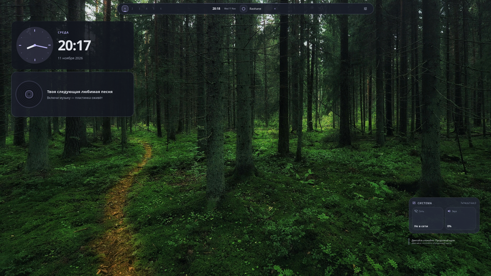
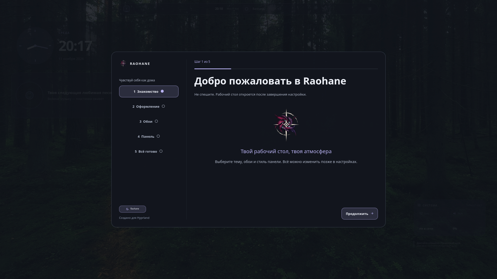
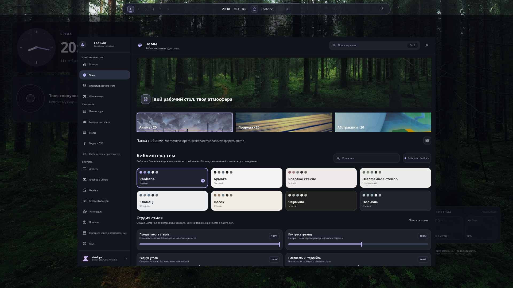
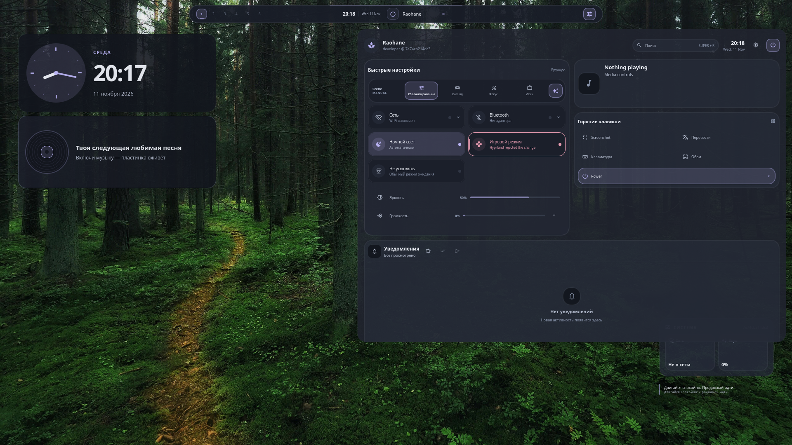
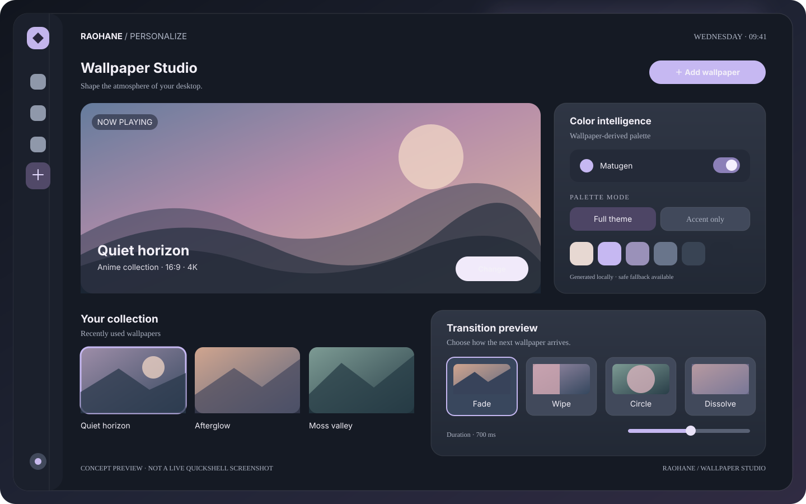

<!--
  README проекта Raohane
  Изображения assets/screenshots — реальные необработанные снимки Quickshell.
  SVG Wallpaper Studio — концепт, а не скриншот работающей оболочки.
-->

<div align="center">


# Raohane

### Твой рабочий стол. Твоя атмосфера.

Настраиваемая оболочка рабочего стола для **Hyprland** на **Quickshell, Qt и QML**.

Мягкие графитовые поверхности, сдержанные акценты, адаптивные цвета и плавная анимация —  
единая среда, которую можно настроить под свой рабочий процесс.

<p>
  <a href="#галерея">Галерея</a> ·
  <a href="#возможности">Возможности</a> ·
  <a href="#установка">Установка</a> ·
  <a href="#документация">Документация</a>
</p>

[English](README.md) · [Русский](README.ru.md)

[](https://github.com/killmyselfrin/raohane-dots/actions/workflows/raohane-audit.yml)
[](LICENSE)


<a href="assets/screenshots/desktop.png">
  
</a>

<sub>Реальный необработанный снимок Quickshell · 1920 × 1080 · диагностическая сессия Sway с программным рендерингом.</sub>

</div>

---

## Что такое Raohane?

Raohane — самостоятельная оболочка рабочего стола для **Hyprland**. Она объединяет основные элементы рабочего окружения: настраиваемую панель, Dock, лаунчер, Центр управления, библиотеку обоев, медиаинтерфейс, виджеты и единое окно настроек с поиском.

В основе проекта три принципа:

- **Единый визуальный язык.** Общие поверхности, типографика, отступы, цвета и анимации во всех элементах оболочки.
- **Практичная настройка.** Управление расположением, модулями, виджетами, темами и обоями без набора несвязанных утилит.
- **Предсказуемая работа.** Нативные сервисы Quickshell, ограниченная фоновая нагрузка и резервные механизмы вместо лишних демонов и постоянного опроса системы.

Raohane активно разрабатывается и пока не позиционируется как полностью проверенный стабильный релиз.

## Галерея

Это **снимки реально запущенного интерфейса Quickshell**, а не сгенерированные макеты. Снимки сделаны 11 ноября 2026 года из исходного коммита `a038d025024a5aeee9a70a55de183ed469478ac5`.

<table>
<tr>
<td width="50%" valign="top">
<a href="assets/screenshots/welcome.png"></a>

**Приветствие**

<sub>Первоначальная настройка и выбор оформления.</sub>
</td>
<td width="50%" valign="top">
<a href="assets/screenshots/settings.png"></a>

**Настройки**

<sub>Библиотека тем и переход к выбору обоев.</sub>
</td>
</tr>
<tr>
<td colspan="2">
<a href="assets/screenshots/control-center.png"></a>

**Центр управления**

<sub>Быстрые переключатели и системные элементы. Набор доступных устройств зависит от диагностической среды.</sub>
</td>
</tr>
</table>

<details>
<summary><strong>Условия съёмки и ограничения</strong></summary>

Снимки сделаны напрямую через `grim` в разрешении 1920 × 1080 логических пикселей, масштаб 1. Использовались Quickshell 0.3.2 / Qt 6.11.2, headless-сессия Sway + pixman и `QT_QUICK_BACKEND=software`. В контейнере не было доступного GPU, поэтому Hyprland не смог запустить графический backend.

Снимки показывают отрисованный интерфейс, но **не подтверждают аппаратный рендеринг в Hyprland, размытие композитора, производительность GPU, работу реальных устройств, несколько мониторов или стабильность при длительной работе**. Для этого необходимы испытания на целевой системе.

Обои рабочего стола — «Path» автора Risto Saukonpää из KDE Plasma Workspace Wallpapers (LGPLv3). Для остальных изображений сохранены исходные сведения об авторах. Полные условия съёмки и источники: [assets/screenshots/README.md](assets/screenshots/README.md).

</details>

### Wallpaper Studio — концепт интерфейса

<p align="center">
  
</p>

<sub>Это **визуальная концепция**, а не скриншот работающего приложения. Она демонстрирует предполагаемую Material-компоновку и управление палитрой.</sub>

## Возможности

| Раздел | Возможности |
| --- | --- |
| **Bar & Dock** | Горизонтальная и вертикальная панели, настройка порядка модулей, индикаторы рабочих пространств, автоскрытие, часы, Context Island и несколько визуальных пресетов. |
| **Wallpaper Studio** | Библиотека обоев, избранное, сохранённые папки, отдельные обои для мониторов, видеопредпросмотр, расписание смены и адаптивные цвета. |
| **Темы и оформление** | Общая система тем Raohane, встроенные пресеты, импорт и экспорт пользовательских тем, настройка плотности интерфейса и анимаций. |
| **Динамические цвета** | Встроенное извлечение палитры, необязательный Matugen, окрашивание акцентов и полная палитра Material You. |
| **Переходы обоев** | Случайный или пользовательский режим; Fade, Wipe, Circle и Dissolve для статичных изображений. |
| **Widget Studio** | Виджеты часов, медиа/контекста и системы; стили Classic, Minimal и Aurora; изменение расположения на рабочем столе. |
| **Launcher & Overview** | Поиск приложений и действий с клавиатуры, навигация по рабочим пространствам и обзор окон. |
| **Центр управления** | Сеть, Bluetooth, звук, микрофон, яркость, уведомления и быстрые системные действия. |
| **Медиа** | Управление MPRIS, обложки, тексты песен, музыкальная капсула и полноэкранный оверлей. |
| **Утилиты** | Скриншоты, запись экрана, OCR/перевод, история буфера обмена, экранная клавиатура, диспетчер задач и управление сеансом. |
| **Scenes** | Профили поведения Balanced, Gaming, Focus и Work. |

Доступность функций зависит от установленных дополнительных пакетов и текущей сессии рабочего стола. Перед использованием аппаратно-зависимых возможностей ознакомьтесь с соответствующей документацией.

## Установка

### Arch Linux и производные

Raohane рассчитана на уже настроенную сессию **Hyprland**. Клонируйте репозиторий и запустите мастер установки:

```bash
git clone https://github.com/killmyselfrin/raohane-dots.git
cd raohane-dots
bash install.sh
```

Установщик проверит зависимости, покажет план изменений и запросит разрешение перед системными действиями. Перед продолжением проверьте список пакетов.

Для установки без интерактивного подтверждения:

```bash
bash install.sh --yes
```

Этот режим принимает стандартные варианты установщика. Драйверы GPU автоматически не заменяются.

Зависимости разделены на два списка:
- [Обязательные пакеты](install/arch/required.txt)
- [Дополнительные пакеты функций](install/arch/features.txt)

### NixOS / Home Manager

Flake предоставляет пакет, модуль NixOS и модуль Home Manager. Инструкции — в [руководстве по Nix](docs/NIX.md) и [описании модулей](nix/).

## Обновление

Выполняйте команды из каталога, в котором установлен исходный репозиторий:

```bash
git pull --ff-only
./install-raohane.sh --no-deps --no-login-theme
raohane restart
```

Одного обновления Git недостаточно для замены установленной оболочки в `~/.config/quickshell/raohane`. Повторно запустите установщик, если изменились runtime-зависимости или файлы установки.

## Команды

| Команда | Назначение |
| --- | --- |
| `raohane launcher` | Открыть лаунчер приложений |
| `raohane control` | Открыть Центр управления |
| `raohane settings` | Открыть настройки |
| `raohane media` | Открыть медиаоверлей |
| `raohane desktop` | Открыть управление рабочим столом |
| `raohane wallpaper` | Открыть выбор обоев |
| `raohane session` | Открыть управление сеансом и питанием |
| `raohane translate` | Запустить перевод экрана |
| `raohane doctor all` | Проверить установку и зависимости |
| `raohane doctor performance` | Проверить CPU, RSS, потоки и перезапуски сервисов |
| `raohane validate smoke` | Проверить IPC текущей сессии и важные ошибки QML |

Поиск лаунчера поддерживает названия приложений, `/` для действий, `>` для команд, `=` для вычислений и `:` для истории буфера обмена.

## Темы и конфигурация

Основной файл настроек:

```text
~/.config/raohane/native.json
```

Пользовательские темы хранятся отдельно:

```text
~/.config/raohane/themes.json
```

Для повседневной настройки рекомендуется использовать графический интерфейс Settings. CLI позволяет просматривать, импортировать, экспортировать и удалять пользовательские пресеты:

```bash
raohane theme list
raohane theme import ~/Downloads/my-theme.json
raohane theme export my-theme ~/Downloads/my-theme.json
raohane theme remove my-theme
```

Формат JSON и правила проверки описаны в документе [Темы](docs/THEMES.md).

### Цвета обоев и Matugen

Wallpaper Studio поддерживает встроенное извлечение палитры и необязательный провайдер **Matugen**. Для работы Raohane Matugen не требуется.

- Встроенный провайдер остаётся резервным вариантом, если Matugen не установлен или вернул некорректные данные.
- Matugen запускается ограниченно, без интерактивного режима, с `--dry-run` и временной изолированной конфигурацией. Пользовательские шаблоны и хуки Matugen не загружаются.
- Палитра может использоваться для Adaptive Accent / Bar Chromatic Flow. Полный режим Material You сопоставляет проверенные роли Material с общей темой Raohane.
- Для видеообоев используется один ограниченный по времени стоп-кадр; постоянного анализа видео нет.

Установите Matugen отдельно по [официальной инструкции](https://github.com/InioX/matugen). Подробности реализации и ограничения описаны в [документе редизайна Wallpaper Studio](docs/WALLPAPER-STUDIO-MATERIAL-REDESIGN.md).

## Состояние проекта и проверки

**Текущая версия исходников:** `1.3.0-dev` ([VERSION](VERSION)).

Raohane активно разрабатывается. Автоматические аудиты проверяют границы исходного кода, контракты конфигурации, локализацию и отдельные интеграционные условия. Они **не гарантируют**, что все функции корректно работают на любой конфигурации Hyprland/GPU.

Перед выпуском необходимо проверить на реальном оборудовании: установку и обновление, горизонтальную/вертикальную панель, фокус и горячие клавиши, несколько мониторов, полноэкранные приложения и игры, аудио/сеть, изображения и видеообои, PAM/Polkit, сон/пробуждение и потребление ресурсов при длительной работе.

Полезные проверки:

```bash
bash scripts/raohane-audit.sh
bash scripts/runtime-payload-audit.sh
raohane doctor all
raohane validate smoke
```

Полная процедура проверки релиза описана в [Release validation](docs/RELEASE-VALIDATION.md). Известные задачи стабилизации находятся в [Roadmap](docs/ROADMAP.md).

## Документация

- [Архитектура](docs/ARCHITECTURE.md)
- [План развития](docs/ROADMAP.md)
- [Проверка релиза](docs/RELEASE-VALIDATION.md)
- [Формат тем и пользовательские пресеты](docs/THEMES.md)
- [Wallpaper Studio 2.0](docs/WALLPAPER-STUDIO-2-VALIDATION.md)
- [Редизайн Wallpaper Studio и Matugen](docs/WALLPAPER-STUDIO-MATERIAL-REDESIGN.md)
- [Панель, Welcome и коллекция обоев](docs/BAR-WELCOME-PACK-VALIDATION.md)
- [Halo Bar и Chromatic Flow](docs/HALO-BAR-VALIDATION.md)
- [Библиотека стилей виджетов](docs/WIDGET-FACE-LIBRARY.md)
- [NixOS / Home Manager](docs/NIX.md)
- [Участие в разработке](CONTRIBUTING.md)
- [Локализация](translations/l10n/README.md)
- [История изменений](CHANGELOG.md)
- [Условия съёмки и авторство изображений](assets/screenshots/README.md)

## Авторство и лицензия

Разработчик и сопровождающий Raohane — [@killmyselfrin](https://github.com/killmyselfrin).

Проект распространяется по лицензии [GNU General Public License v3.0](LICENSE). Для сохранённых или адаптированных компонентов, переводов и ассетов действуют соответствующие лицензии и требования к указанию авторства. См. [NOTICE-UPSTREAM.md](NOTICE-UPSTREAM.md), [авторство обоев](assets/wallpapers/README.md) и [примечания к скриншотам](assets/screenshots/README.md).
